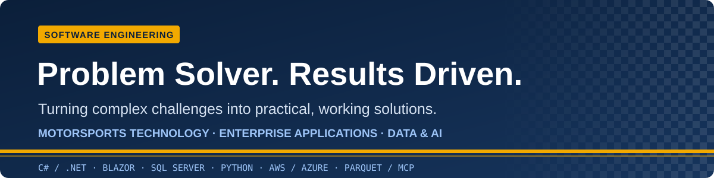

# Tony Honesto

**Software Engineer | Motorsports Technology | C#/.NET | Data & AI**

  

  
  
  
  

I build software that solves real-world problems, turning complex requirements into practical applications, reliable data workflows and tools people can use. My experience spans motorsports technology, race operations, enterprise applications, data engineering and AI-assisted development.

I work with engineers and stakeholders to understand the problem, build a useful solution, and carry it through testing and delivery. That work has included race timing and scoring, EDI and HL7 integrations, enterprise application modernization, and making data accessible to analytics and AI tools.

## What I Build

- **Engineering and race operations applications:** C#/.NET and Blazor tools backed by SQL Server, with practical workflows, clear data contracts and automated checks.
- **Data engineering and integration:** ingestion pipelines, APIs and migrations that connect enterprise systems and make data usable for analysis, including EDI, HL7 and BizTalk-to-Azure integration work.
- **AI and analytics tools:** MCP servers for querying Parquet data, sports analytics demonstrations, and model workflows with explicit confidence and fallback behavior.
- **Software delivery improvements:** AI-assisted development supported by validation, tests, CI and evidence of where rework or bottlenecks occur.

- ✍️ **Writing:** [142 articles](https://github.com/atonyhonesto/tech-articles) on cloud, integration, data, AI and motorsports tech; 81 of them link to code you can run.
- 🏁 **Roots:** timing & scoring at the Indy 500, NASCAR Race Control, Pi Research data acquisition, Optimum G vehicle dynamics.
- 🏎️ [Motorsports related content](https://github.com/search?q=user%3Aatonyhonesto+topic%3Amotorsport&type=repositories) — race data, telemetry, strategy and simulation repositories.
- 🤝 **Open to:** software engineering opportunities across motorsports technology, enterprise applications, data and AI.

---

## Technologies I Work With

**Languages and frameworks** 

**Cloud and delivery** 

**Integration & data** 

**AI & ML** 

---

## Featured Projects

<table>
<tr>
<td colspan="2" valign="top">

#### 🏀 [basketball-parquet-mcp](https://github.com/atonyhonesto/basketball-parquet-mcp)
The NBA basketball-team use-case follow-up to my original [Parquet MCP server](https://github.com/atonyhonesto/ParquetMCPServer): natural-language player and series analysis over local Parquet files. This independent public reconstruction includes a runnable C#/.NET 10 MCP server, fictional basketball data, a 30-question catalogue and tested cross-game shooting calculations. No private team data or correspondence is published.

   

</td>
</tr>
<tr>
<td colspan="2" valign="top">

#### 🏎️ [motorsport-data-platform-blueprint](https://github.com/atonyhonesto/motorsport-data-platform-blueprint)
An independent architecture concept for making governed race data usable by AI assistants, simulation and digital twins. Includes a presentation outline, MCP tool contract, tenant-isolation controls and a historical-data pilot plan. Architecture and design material, not a deployed platform.

   

</td>
</tr>
<tr>
<td colspan="2" valign="top">

#### 🏎️ [pitwall-readiness](https://github.com/atonyhonesto/pitwall-readiness)
A pre-session race-operations board built with Blazor and .NET 8. Critical checks gate session readiness, concurrent edits are protected, and every change is recorded in a transactional SQL Server audit log. Parameterized ADO.NET, no Entity Framework, with sample data, unit tests and SQL integration tests in GitHub Actions.

   

</td>
</tr>
<tr>
<td width="50%" valign="top">

#### 🏁 [race-speed-inference](https://github.com/atonyhonesto/race-speed-inference)
A pit call has to be on the wall in 25 ms. Per-stage latency budgets, a hard inference timeout, a dual-threshold confidence gate, calibration, drift detection and three-tier fallback, run against a simulated 200-lap race.

  

</td>
<td width="50%" valign="top">

#### 🔌 [ParquetMCPServer](https://github.com/atonyhonesto/ParquetMCPServer)
A Model Context Protocol server in C# that lets Claude Code discover schemas and query local Parquet files from plain-English questions. No SQL, no cloud dependency.

  

</td>
</tr>
<tr>
<td width="50%" valign="top">

#### 🏥 [logicapp-hl7-adt-a01-decoder](https://github.com/atonyhonesto/logicapp-hl7-adt-a01-decoder)
Azure Logic App Standard workflow that decodes HL7 v2 ADT^A01 admissions into validated JSON using the built-in HL7 connector and namespace-agnostic XPath. No hand-rolled parsing.

  

</td>
<td width="50%" valign="top">

#### 🔄 [biztalk-azure-modernization](https://github.com/atonyhonesto/biztalk-azure-modernization)
Case study: moving a logistics company's high-volume EDI platform from on-prem BizTalk to Azure Integration Services. Roadmap, parallel runs, cutover and the team's skills transition.

  

</td>
</tr>
<tr>
<td width="50%" valign="top">

#### 🧪 [article-labs](https://github.com/atonyhonesto/article-labs)
50 small, runnable apps behind my articles: tire degradation and pit windows, Kafka consumer groups, RAG retrieval, medallion SQL, gRPC, a Java quality gate, WPF MVVM, Terraform. One command each, every lab tested in CI.

   

</td>
<td width="50%" valign="top">

#### 🚀 [csharp-fargate-stepfunctions](https://github.com/atonyhonesto/csharp-fargate-stepfunctions)
A C# batch job on AWS Fargate, orchestrated by Step Functions: exit codes decide retry or fail, SIGTERM is handled cleanly, and the state machine is tested offline against the real job code.

  

</td>
</tr>
</table>

More companion code: <a href="https://github.com/atonyhonesto/edi-x12-mapper">edi-x12-mapper</a> · <a href="https://github.com/atonyhonesto/signalr-vs-sse-dotnet10">signalr-vs-sse-dotnet10</a> · <a href="https://github.com/atonyhonesto/race-data-redis-streams">race-data-redis-streams</a> · <a href="https://github.com/atonyhonesto/oauth2-pkce-jwt-walkthrough">oauth2-pkce-jwt-walkthrough</a> · <a href="https://github.com/atonyhonesto/nodejs-architecture-patterns">nodejs-architecture-patterns</a> · <a href="https://github.com/atonyhonesto/ai-coding-tax-analyzer">ai-coding-tax-analyzer</a> · <a href="https://github.com/atonyhonesto/watch-session-tracker-lightweight">watch-session-tracker</a>

<b>📰 <a href="https://github.com/atonyhonesto/tech-articles">tech-articles</a></b>: every LinkedIn article, sorted by theme, with one-page visual deep dives and links to code.

---

## Latest on LinkedIn

Recent posts and selected articles, grouped by engineering theme, with links to runnable companion projects.

#### MCP and sports analytics

- [Local C# MCP Server for Parquet Data](https://www.linkedin.com/pulse/local-c-mcp-server-parquet-data-tony-honesto-wu7qf/) — The original C# foundation for discovering schemas and querying local Parquet data. · [code](https://github.com/atonyhonesto/ParquetMCPServer)
- [Parquet for Analytics & Feature Consumption](https://www.linkedin.com/pulse/parquet-analytics-feature-consumption-tony-honesto-oww7c/) — Columnar datasets as inputs to analytics and feature workflows. · [code](https://github.com/atonyhonesto/article-labs/tree/main/labs/parquet-feature-store)
- [Python Machine Learning in Motorsports](https://www.linkedin.com/pulse/python-machine-learning-motorsports-tony-honesto-aqmmc/) — A motorsport application of machine learning, with a tire-degradation and pit-window example. · [code](https://github.com/atonyhonesto/article-labs/tree/main/labs/tire-deg-pit-window)
- [AI/ML at Race Speed — Low-Latency Inference, Confidence Thresholds & Fallback Logic](https://www.linkedin.com/pulse/aiml-race-speed-low-latency-inference-confidence-fallback-honesto-hwmbc/) — Latency budgets, confidence thresholds and fallback behavior around a race-day model. · [code](https://github.com/atonyhonesto/race-speed-inference)

#### AI assisted development and delivery quality

- [The AI Coding Tax — Stop AI Tools From Quietly Accumulating Technical Debt](https://www.linkedin.com/pulse/ai-coding-tax-stop-tools-from-quietly-accumulating-debt-tony-honesto-ikagc/) — Code churn, rework and hotspots: evidence for where faster code generation creates downstream work. · [code](https://github.com/atonyhonesto/ai-coding-tax-analyzer)
- [ChatGPT vs Codex for a Product Requirement](https://www.linkedin.com/pulse/chatgpt-vs-codex-product-requirement-tony-honesto-rcgbc/) — Comparing AI tools through a product-requirement task.
- [Leveraging XP Practices](https://www.linkedin.com/pulse/leveraging-xp-practices-tony-honesto-fesyc/) — Engineering practices for iterative software delivery.
- [Why Most AI Projects Don't Deliver](https://www.linkedin.com/pulse/why-most-ai-projects-dont-deliver-tony-honesto-yuhac/) — Moving from an AI experiment to an evaluated outcome. · [code](https://github.com/atonyhonesto/article-labs/tree/main/labs/ai-eval-harness)

#### Application design and dependable APIs

- [Three Stakeholders, One Proof of Concept: Building a Real-Time Watch Session Tracker](https://www.linkedin.com/pulse/three-stakeholders-one-proof-concept-tony-honesto-rvkqc/) — Stakeholder requirements, validation, deduplication and the trade-offs behind a real-time service. · [code](https://github.com/atonyhonesto/watch-session-tracker-lightweight)
- [SignalR vs .NET 10 Server-Sent Events - Real-Time Communication](https://www.linkedin.com/pulse/signalr-vs-net-10-server-sent-events-real-time-tony-honesto-ofigc/) — Two approaches to a live race feed in ASP.NET Core, with shared data and automated tests. · [code](https://github.com/atonyhonesto/signalr-vs-sse-dotnet10)
- [OAuth 2.0 in Modern Applications](https://www.linkedin.com/pulse/oauth-20-modern-applications-tony-honesto-b3aec/) — Authorization code flow, PKCE and JWT validation, backed by a runnable walkthrough. · [code](https://github.com/atonyhonesto/oauth2-pkce-jwt-walkthrough)

#### AWS processing and data workflows

- [AWS Lambda](https://www.linkedin.com/pulse/aws-lambda-tony-honesto-5risc/) — Event-driven processing, illustrated with race events and Python handlers. · [code](https://github.com/atonyhonesto/article-labs/tree/main/labs/lambda-race-events)
- [Amazon S3](https://www.linkedin.com/pulse/amazon-s3-tony-honesto-o8hmc/) — Object storage and a companion telemetry-data layout example. · [code](https://github.com/atonyhonesto/article-labs/tree/main/labs/s3-telemetry-lake)
- [Deploying a C# Console Application to AWS Fargate](https://www.linkedin.com/pulse/deploying-c-console-application-aws-fargate-tony-honesto-yejac/) — C# batch processing, container execution and Step Functions orchestration. · [code](https://github.com/atonyhonesto/csharp-fargate-stepfunctions)

**Also recent:** [Agent Reach | Give your AI Agent Eyes to see the entire Internet](https://www.linkedin.com/pulse/agent-reach-give-your-ai-eyes-see-entire-internet-tony-honesto-vemkc/).

**Related portfolio work:** [Pitwall Readiness](https://github.com/atonyhonesto/pitwall-readiness) — Blazor/.NET 8, SQL Server and parameterized ADO.NET; [Basketball Parquet MCP](https://github.com/atonyhonesto/basketball-parquet-mcp) — the NBA-team use-case follow-up with synthetic data and tested shooting calculations; [Motorsport Data Platform Blueprint](https://github.com/atonyhonesto/motorsport-data-platform-blueprint) — governed AI and simulation access as an architecture concept.

→ <a href="https://github.com/atonyhonesto/tech-articles">Browse all 142 articles by theme</a> · <a href="https://github.com/atonyhonesto/article-labs">run the article labs</a>

---

## From the timing stand to the cloud

| Where | What I did there |
|---|---|
| **Cigna** | Cloud Engineering Advisor on Azure; built a Splunk MLTK model that forecast disk exhaustion before it happened |
| **NASCAR** | Competition Technology Operator in Race Control at crown-jewel events |
| **ProTrans International** | Cloud engineer & EDI developer; led the BizTalk → Azure Integration Services migration |
| **Ascension / St. Vincent Health** | Technology engineering lead; BizTalk EDI and Azure Integration Accounts for healthcare |
| **Indianapolis Motor Speedway & Team Green** | Timing & scoring implementation with AMB i.t. for the Indy 500; IRL consulting |

---

## Certifications and Training

- AWS Knowledge badges: **Events and Workflows** · **Cloud Essentials** · **Serverless** ([Credly](https://www.credly.com/users/tony-honesto))
- OpenAI: **Building Agents**
- Pi Research: **data acquisition**
- Optimum G: **vehicle dynamics**

---

<i>Every lap is a data event. The job is making sure the data gets where it needs to go.</i>

